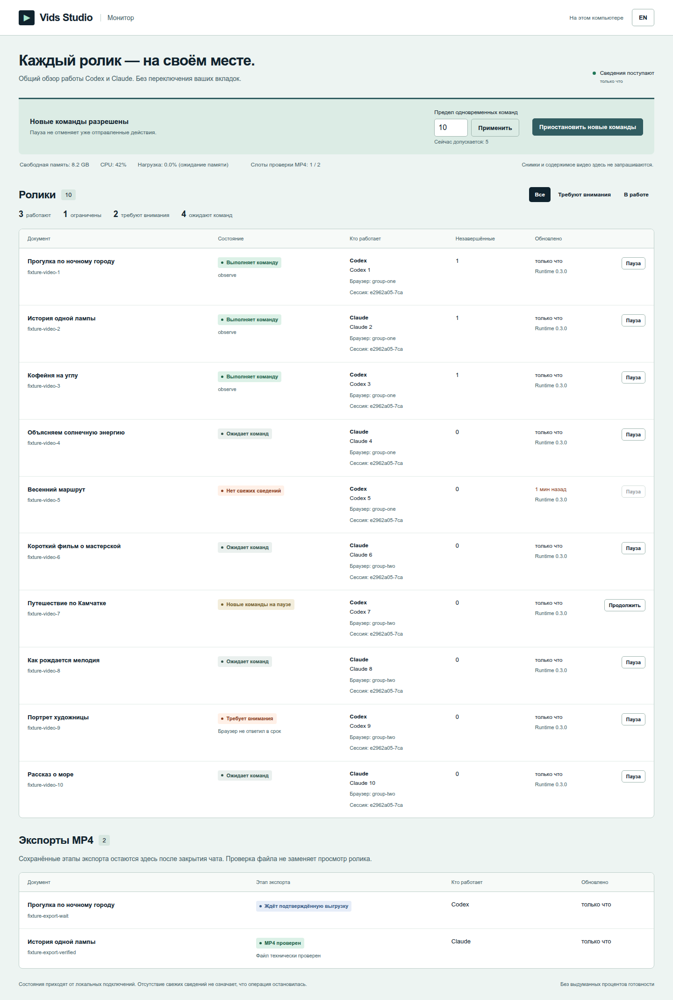
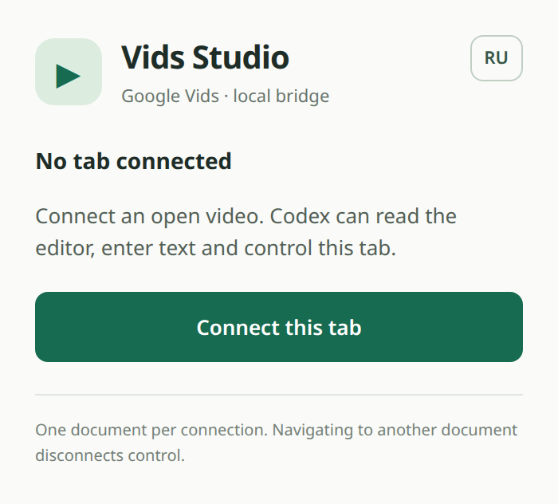

<p align="center">
  
</p>

<p align="center"><strong>Give your agent a brief. Build and refine an editable video in Google Vids.</strong><br>Creative skills, a local MCP connector, and Chrome extensions for Codex and Claude Code.</p>

<p align="center"><strong>English</strong> · <a href="README.ru.md">Русский</a></p>

<p align="center">
  <a href="https://github.com/Shugar86/vids-studio/actions/workflows/ci.yml"></a>
  <a href="https://github.com/Shugar86/vids-studio/releases/tag/v0.4.0"></a>
  
</p>

<p align="center"><a href="https://shugar86.github.io/vids-studio/">Watch the demo</a> · <a href="#start-here">Install</a> · <a href="#what-you-can-do">Use cases</a> · <a href="#how-it-works">How it works</a> · <a href="docs/en/usage.md">Guide</a></p>

## Your video, still in the editor

Vids Studio connects Codex or Claude Code to **the Google Vids document you choose**. Describe the audience, idea and desired result. The agent uses a creative skill to plan the video, observes the editor, makes changes and checks what happened. You keep an editable Vids project that you can continue working on yourself.

The skill provides the production method; the connector gives the agent eyes and hands inside the attached tab. Together they support work on story, shots, voice, captions, pacing and sound—using the features available in your Vids account. The bridge uses no system mouse, keyboard or clipboard, so it does not take over your desktop.

## Several videos, one monitor

The **0.4 preview** supports several explicitly attached documents per client, a private assignment for each chat, adaptive command limits and a shared local monitor for Codex and Claude. Start the monitor with `bun run monitor`; pause new commands for one video or the whole group without using the system mouse or keyboard. This does not pause the model or a Google generation already in progress. Export runners survive their MCP client's exit, with separately bounded local MP4 verification.

[Connect 5–10 chats and understand the limits →](docs/en/parallel.md)

<details><summary>Monitor preview · synthetic examples</summary>


</details>

The archives below include these changes. Ten parallel `codex exec` processes passed isolated-browser acceptance; live multi-film editing in Google Vids remains a separate check. [What was tested and on which build](docs/en/testing.md#parallel-agent-acceptance).

Source builds from `main` also give both profiles the same [montage and media tools](https://github.com/Shugar86/vids-studio/blob/main/skill/google-vids/references/en/client-tools.md): scenes and transitions, PNG layers, website capture, SRT, blind ASR and frame-cut review. These additions are not yet in the published v0.4.0 ZIP files; see the [changelog](CHANGELOG.md).

## Watch a real edit

<p align="center">
  <a href="https://shugar86.github.io/vids-studio/"></a>
</p>

**Sasha and the lamp · Claude v5.** The creator’s preferred cut: a Russian-language short assembled in Google Vids with Claude Code. The lamp turns away while Sasha stays in the shot. This version cleans up duplicate captions, adjusts the cuts to the spoken words and replaces the final lamp movement.

[**Play the 45.5-second demo**](https://shugar86.github.io/vids-studio/) · [What changed and what was checked](docs/en/demo.md) · [Download MP4 · 8 MB](https://shugar86.github.io/vids-studio/assets/sasha-and-the-lamp-v5.mp4)

The published MP4 was checked, including full decoding and preservation of picture and sound when removing the extra subtitle track. Live acceptance of the complete automated `export_mp4` workflow remains a separate requirement.

## What you can do

| Start with… | Work toward… |
| --- | --- |
| **A brief and your materials** | A product explainer, onboarding video or short presentation with a clear story, readable text and a purposeful ending. |
| **An existing rough cut** | A stronger opening, tighter pacing, a replacement shot or a cleaner transition—while retaining earlier takes and checking nearby edits. |
| **A video ready for review** | A review of picture, words, sound and viewer understanding, with observed problems separated from things the agent could not inspect. |

This is a production workflow, not a guarantee that every available Google AI feature will produce the intended result on its first attempt. Generation, voices, avatars and other editor features depend on your account and the current Google Vids interface.

## From brief to reviewed sequence

1. **Find the point.** Define who the video is for and what they should understand, feel or do afterward.
2. **Prove the opening.** Build and review a representative beginning before extending its style across the whole video.
3. **Make and assemble.** Choose references and media, shape scenes, and keep narration, on-screen text and shot timing distinct.
4. **Refine the edit.** Adjust pacing, captions, voice and music. Preserve previous takes when replacing material and recheck the affected neighbors.
5. **Review the result.** Inspect the sequence across picture, speech, sound and clarity. Verify an export separately when the supported export workflow is available.

A successful click is evidence of an action, not proof of a good scene. The skills carry that distinction through the workflow. [Read the creative guide →](docs/en/usage.md)

## How it works

<p align="center">
  
</p>

You connect the intended document through the extension. The agent checks the connection, acquires control for its task, observes the editor, performs an action and observes again to verify the result. When finished, it releases control.

| Part | What it contributes |
| --- | --- |
| **Creative skill** | Guides the agent through the brief, scenes, references, voice, editing and review. The entry point is `google-vids` in Codex and `vids-director` in Claude Code. |
| **Local MCP connector** | Gives the agent structured tools for observations, screenshots, clicks, dragging, text, authorized media uploads and recovery. MCP is the protocol through which the AI client calls these tools. |
| **Chrome extension** | Connects the document you select and carries out actions inside that tab. Separate Codex and Claude profiles keep their connections distinct. |
| **Local media helpers** | Prepare graphics, create review frame sheets, inspect media and retain a history of takes. They support production and review; they do not replace the Vids editor. |

<p align="center">
  <br>
  <sub>The real extension popup, before connection. Its EN / RU switch changes the interface language.</sub>
</p>

Both profiles can work on different documents independently. If they target the same document, one task receives control and the other receives `CONTROL_BUSY`; this requires the updated runtime in both profiles. Human editing remains possible. If an action's outcome is unknown, the agent must inspect it before continuing rather than repeat it blindly.

**Where data goes.** The connector runs locally: a private Unix socket on Linux/macOS and mutually authenticated loopback on Windows; it does not open a public TCP service, read cookies or passwords, or discover unrelated tabs. Editor observations and screenshots reach your AI client. Google Vids still sends its normal editor traffic and uploaded media to Google. Chrome's `debugger` permission is broad; document-only operation is a restriction enforced by this implementation. [Architecture, permissions and recovery →](docs/en/architecture.md)

## Start here

**Installation: Windows, macOS and Linux (preview).** You need Node.js **22.13+**, Python **3.11+**, Bun, Google Chrome **118+**, your own Codex or Claude Code installation, and access to Google Vids. FFmpeg/ffprobe are needed for export verification and media helpers. The declared minimum versions are not a claim that every combination has been tested. The bridge needs no separate model API key or Google OAuth application.

Choose a client archive from the [v0.4.0 preview release](https://github.com/Shugar86/vids-studio/releases/tag/v0.4.0):

| Codex | Claude Code | Development |
| --- | --- | --- |
| [Download Codex ZIP](https://github.com/Shugar86/vids-studio/releases/download/v0.4.0/vids-studio-0.4.0-codex.zip) | [Download Claude ZIP](https://github.com/Shugar86/vids-studio/releases/download/v0.4.0/vids-studio-0.4.0-claude.zip) | [Download source ZIP](https://github.com/Shugar86/vids-studio/releases/download/v0.4.0/vids-studio-0.4.0-source.zip) |

Check downloads against [SHA256SUMS](https://github.com/Shugar86/vids-studio/releases/download/v0.4.0/SHA256SUMS). Extract the selected profile into a **permanent directory**. Dependencies are installed separately. Open the instructions for your client:

**Windows:** follow the [PowerShell commands](docs/en/platforms.md#windows--powershell) with a dedicated Python environment. The commands below are for Linux/macOS. [Platform details and checks →](docs/en/platforms.md)

<details>
<summary><strong>Set up Codex</strong></summary>

Inside the extracted Codex directory:

```sh
bun install --frozen-lockfile
python3 scripts/setup.py --profile codex
python3 scripts/setup.py --profile codex --install
```

The first setup command shows the planned changes. The second registers the native host, the `google-vids` MCP server and the `google-vids` skill. Load this directory's `extension` in Chrome using the steps below.

Prefer to build from source? Run this instead of extracting the archive, then run the same setup commands:

```sh
git clone https://github.com/Shugar86/vids-studio.git
cd vids-studio
python3 scripts/build_profiles.py --profile codex --target ../vids-studio-codex --write
cd ../vids-studio-codex
```

</details>

<details>
<summary><strong>Set up Claude Code</strong></summary>

Inside the extracted Claude directory:

```sh
bun install --frozen-lockfile
python3 scripts/setup.py --profile claude
python3 scripts/setup.py --profile claude --install
```

The first setup command shows the planned changes. The second registers the native host, the `vids-claude` MCP server and the `vids-director` skill. Load this directory's `extension` in Chrome using the steps below. This installer configures Claude Code, not Claude Desktop.

Prefer to build from source? Run this instead of extracting the archive, then run the same setup commands:

```sh
git clone https://github.com/Shugar86/vids-studio.git
cd vids-studio
python3 scripts/build_profiles.py --profile claude --target ../vids-studio-claude --write
cd ../vids-studio-claude
```

</details>

Then connect the editor:

1. Open `chrome://extensions`, enable **Developer mode**, choose **Load unpacked**, and select the installation's `extension` directory.
2. Open your intended Google Vids document. Click **Vids Studio** for Codex or **Vids Studio · Claude** for Claude Code, then connect that tab.
3. Refresh the client's MCP connection. Ask the agent to run `vids_diagnostics` and `vids_status`, and verify `compatibility.ready: true`, `attached: true`, and the intended document.

Setup preserves unrelated settings and stops on conflicting registrations. Keep each installation directory in place; the registered paths point to it. For two-client setup, existing installations, updates and rollback, use the [complete installation guide](docs/en/installation.md).

## Try a brief

In Codex, use **google-vids**; in Claude Code, replace that name with **vids-director**.

**Create a short explainer**

```text
Use google-vids in the connected document. Make a 35-second English
onboarding video for first-time users of our product, using the materials
I provide. Show the problem, one concrete action and its visible result.
Use a calm voice and readable captions. Build and review a representative
opening first, then complete the sequence. Preserve the editable project
and tell me what you actually viewed, heard and verified.
```

**Review before changing anything**

```text
Use google-vids to review the connected video without editing it.
Check the opening, pacing, captions, voice and music for a first-time
viewer. Separate technical defects from editorial suggestions.
For each finding, state the evidence and what remains unverified.
```

For focused edits and take replacement, see [more prompts and the review criteria](docs/en/usage.md).

## What is verified

The automated checks cover both profiles: installation and packaging, MCP/native communication, document ownership, browser input, uploads, export handling and local helpers. Browser checks run in disposable profiles with local fixtures, separately from a user's real project. [CI runs](https://github.com/Shugar86/vids-studio/actions/workflows/ci.yml) show results for specific revisions.

**v0.4.0 is a preview.** The current Claude v5 demo has file-level verification. Live acceptance of the typed `export_mp4` workflow still requires evidence from the current loaded build. An earlier Codex v4 run produced a verified file but failed to correlate its download; that historical observation is separate from the current film. [Demo and review limits](docs/en/demo.md) · [Earlier export observation](docs/en/testing.md#codex-v4-export) · [Export details](docs/en/jobs.md)

This is an independent, unofficial project. It does not provide a Google Vids scene API, include Google AI access or bypass account restrictions. Google can change its editor; Chrome and the attached document must remain open.

## Explore the project

| Documentation | Русский |
| --- | --- |
| [Demo: Sasha and the lamp](docs/en/demo.md) | [Деморолик: Саша и лампа](docs/ru/demo.md) |
| [Installation, updates and rollback](docs/en/installation.md) | [Установка, обновление и откат](docs/ru/installation.md) |
| [Creative workflow and tools](docs/en/usage.md) | [Творческий процесс и инструменты](docs/ru/usage.md) |
| [Architecture and permissions](docs/en/architecture.md) | [Архитектура и разрешения](docs/ru/architecture.md) |
| [Troubleshooting](docs/en/troubleshooting.md) | [Решение проблем](docs/ru/troubleshooting.md) |
| [Testing and verified limits](docs/en/testing.md) | [Проверки и границы подтверждения](docs/ru/testing.md) |
| [Experimental export jobs](docs/en/jobs.md) | [Экспериментальные задания экспорта](docs/ru/jobs.md) |

<details>
<summary><strong>Source directory map</strong></summary>

| Directory | Contents |
| --- | --- |
| [`skill/`](skill/) | Client skills, English and Russian creative references, media scripts and helper tests |
| [`server/`](server/) | MCP tools, argument validation and durable export jobs |
| [`native/`](native/) | Python Native Messaging host and shared document coordinator |
| [`extension/`](extension/) | Chrome debugger driver, bilingual popup and export watcher |
| [`profiles/`](profiles/) | Stable, separate extension and client identities |
| [`scripts/`](scripts/) | Profile builds, setup, release packaging and read-only live smoke |
| [`tests/`](tests/) | Unit, process-isolation and disposable-Chromium checks |
| [`docs/`](docs/) | Installation, creative workflow, architecture, troubleshooting and verification guides |

</details>

**Help others discover Vids Studio.** If it fits your workflow, [star the repository](https://github.com/Shugar86/vids-studio) and share it with someone who makes videos in Google Vids. Setup feedback and reproducible issues are welcome.

Want to contribute? Read [CONTRIBUTING.md](CONTRIBUTING.md) and the [testing guide](docs/en/testing.md). Report reproducible problems through [Issues](https://github.com/Shugar86/vids-studio/issues); keep private document content, credentials and control tokens out of reports. See the [security policy](SECURITY.md) for sensitive findings and [CHANGELOG.md](CHANGELOG.md) for release changes.

Developing with an agent? [AGENTS.md](https://github.com/Shugar86/vids-studio/blob/main/AGENTS.md) maps the source, client profiles, required checks and publication rules in English and Russian. [CLAUDE.md](https://github.com/Shugar86/vids-studio/blob/main/CLAUDE.md) adds the Claude entry point.

**License:** [MIT](LICENSE) · Copyright © 2026 Shugar86.
