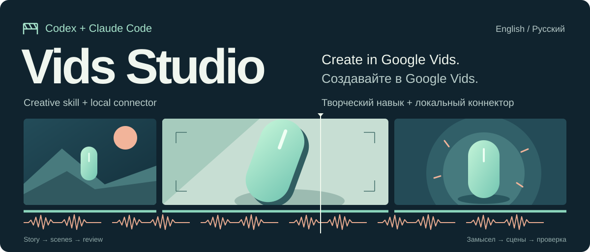
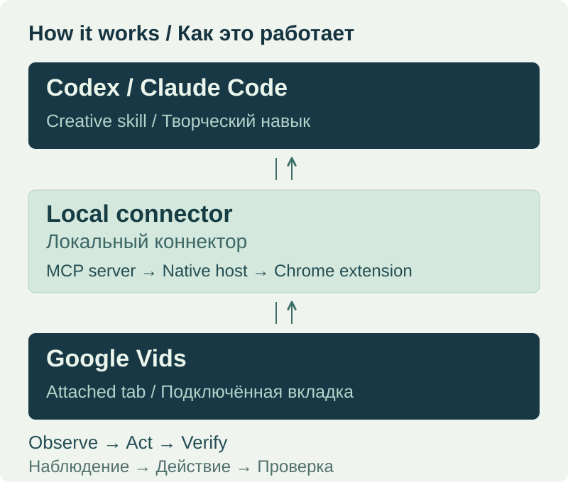
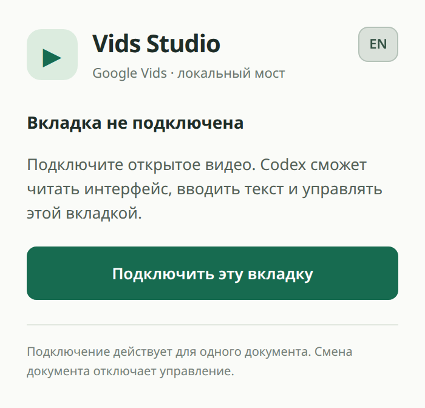

<p align="center">
  
</p>

<p align="center"><strong>Дайте агенту задачу. Соберите и улучшите редактируемое видео в Google Vids.</strong><br>Творческие навыки, локальный MCP-коннектор и расширения Chrome для Codex и Claude Code.</p>

<p align="center"><a href="README.md">English</a> · <strong>Русский</strong></p>

<p align="center">
  <a href="https://github.com/Shugar86/vids-studio/actions/workflows/ci.yml"></a>
  <a href="https://github.com/Shugar86/vids-studio/releases/tag/v0.3.0"></a>
  
</p>

<p align="center"><a href="#начало-работы">Установить</a> · <a href="#для-каких-задач">Возможности</a> · <a href="#как-это-работает">Как это работает</a> · <a href="docs/ru/usage.md">Руководство</a> · <a href="https://github.com/Shugar86/vids-studio/releases/tag/v0.3.0">Скачать</a></p>

## Ваш ролик остаётся в редакторе

Vids Studio подключает Codex или Claude Code к **тому документу Google Vids, который вы выбрали**. Опишите аудиторию, замысел и нужный результат. Агент использует творческий навык, чтобы спланировать ролик, наблюдает редактор, вносит изменения и проверяет, что получилось. У вас остаётся редактируемый проект Vids, с которым можно продолжить работу самостоятельно.

Навык задаёт метод работы над видео; коннектор позволяет агенту видеть интерфейс и действовать внутри подключённой вкладки. Вместе они помогают работать с историей, кадрами, голосом, субтитрами, темпом и звуком — через функции, доступные в вашем аккаунте Vids. Мост не использует системные мышь, клавиатуру и буфер обмена, поэтому не перехватывает ваш рабочий стол.

## Для каких задач

| С чего начать | К чему прийти |
| --- | --- |
| **Задача и ваши материалы** | Ролик о продукте, видео для новых пользователей или короткая презентация с понятной историей, читаемым текстом и осмысленным завершением. |
| **Готовый черновой монтаж** | Более сильное начало, точный темп, замена кадра или аккуратный переход — с сохранением предыдущих дублей и проверкой соседних участков. |
| **Ролик перед сдачей** | Проверка изображения, слов, звука и зрительского понимания, в которой наблюдаемые проблемы отделены от того, что агент не смог проверить. |

Это процесс работы над видео, а не гарантия, что любая функция Google AI даст нужный результат с первой попытки. Генерация, голоса, аватары и другие возможности редактора зависят от аккаунта и текущего интерфейса Google Vids.

## От задачи до проверенной последовательности

1. **Найти главное.** Определить, для кого ролик и что зритель должен понять, почувствовать или сделать после просмотра.
2. **Проверить начало.** Собрать и оценить характерное начало, прежде чем распространять найденный стиль на весь ролик.
3. **Подготовить и собрать.** Выбрать референсы и материалы, выстроить сцены, разделяя речь, экранный текст и длительность планов.
4. **Довести монтаж.** Настроить темп, субтитры, голос и музыку. При замене материала сохранить предыдущие дубли и проверить затронутые соседние участки.
5. **Проверить результат.** Оценить последовательность по изображению, речи, звуку и понятности. Отдельно проверить экспорт, когда доступен поддерживаемый способ выгрузки.

Успешный клик подтверждает действие, но не качество сцены. Навыки сохраняют это различие на протяжении работы. [Подробнее о творческом процессе →](docs/ru/usage.md)

## Как это работает

<p align="center">
  
</p>

Вы подключаете нужный документ через расширение. Агент проверяет соединение, получает управление для своей задачи, наблюдает редактор, выполняет действие и снова наблюдает результат. Закончив работу, он освобождает управление.

| Часть | Для чего нужна |
| --- | --- |
| **Творческий навык** | Ведёт агента через задачу, сцены, референсы, голос, монтаж и проверку. В Codex это `google-vids`, в Claude Code — `vids-director`. |
| **Локальный MCP-коннектор** | Даёт агенту инструменты наблюдения, снимков экрана, кликов, перетаскивания, ввода текста, разрешённой загрузки медиа и восстановления. MCP — протокол, через который AI-клиент вызывает эти инструменты. |
| **Расширение Chrome** | Подключает выбранный вами документ и выполняет действия внутри этой вкладки. Отдельные профили Codex и Claude сохраняют раздельные подключения. |
| **Локальные медиа-помощники** | Готовят графику, создают листы кадров для проверки, исследуют медиа и сохраняют историю дублей. Они помогают производству и проверке, а сам монтаж остаётся в Vids. |

<p align="center">
  <br>
  <sub>Настоящее окно расширения до подключения. Переключатель EN / RU меняет язык интерфейса.</sub>
</p>

Оба профиля могут независимо работать с разными документами. Если они обращаются к одному документу, одна задача получает управление, а другая — `CONTROL_BUSY`; для этого в обоих профилях должна работать обновлённая версия. Ручное редактирование остаётся доступным. Если исход действия неизвестен, агент должен выяснить его перед продолжением, а не повторять действие вслепую.

**Куда уходят данные.** Коннектор работает локально: на Linux/macOS через закрытый Unix socket, на Windows — через loopback с взаимной аутентификацией; не открывает публичный TCP-сервис, не читает cookie и пароли, не ищет посторонние вкладки. Наблюдения редактора и снимки экрана поступают вашему AI-клиенту. Google Vids продолжает отправлять Google обычные запросы редактора и загружаемые медиа. Разрешение Chrome `debugger` широкое; ограничение выбранным документом обеспечивает код этой реализации. [Архитектура, разрешения и восстановление →](docs/ru/architecture.md)

## Начало работы

**Установка: Windows, macOS и Linux (preview).** Нужны Node.js **22.13+**, Python **3.11+**, Bun, Google Chrome **118+**, собственная установка Codex или Claude Code и доступ к Google Vids. Для проверки экспорта и медиа-помощников нужны FFmpeg/ffprobe. Указанные минимальные версии не означают, что проверено каждое сочетание. Самому мосту не нужны отдельный API-ключ модели и приложение Google OAuth.

Выберите архив клиента в [предварительном релизе v0.3.0](https://github.com/Shugar86/vids-studio/releases/tag/v0.3.0):

| Codex | Claude Code | Разработка |
| --- | --- | --- |
| [Скачать ZIP для Codex](https://github.com/Shugar86/vids-studio/releases/download/v0.3.0/vids-studio-0.3.0-codex.zip) | [Скачать ZIP для Claude](https://github.com/Shugar86/vids-studio/releases/download/v0.3.0/vids-studio-0.3.0-claude.zip) | [Скачать исходники](https://github.com/Shugar86/vids-studio/releases/download/v0.3.0/vids-studio-0.3.0-source.zip) |

Сверьте загрузку с [SHA256SUMS](https://github.com/Shugar86/vids-studio/releases/download/v0.3.0/SHA256SUMS). Распакуйте выбранный профиль в **постоянный каталог**. Зависимости устанавливаются отдельно. Откройте инструкцию для своего клиента:

**Windows:** используйте [команды PowerShell](docs/ru/platforms.md#windows--powershell) с отдельным Python-окружением. Команды ниже — для Linux/macOS. [Различия платформ и проверки →](docs/ru/platforms.md)

<details>
<summary><strong>Настроить Codex</strong></summary>

Внутри распакованного каталога Codex:

```sh
bun install --frozen-lockfile
python3 scripts/setup.py --profile codex
python3 scripts/setup.py --profile codex --install
```

Первая команда setup показывает план изменений. Вторая регистрирует native host, MCP-сервер `google-vids` и навык `google-vids`. Загрузите каталог `extension` этой установки в Chrome по шагам ниже.

Хотите собрать из исходников? Вместо распаковки архива выполните эти команды, затем те же команды установки:

```sh
git clone https://github.com/Shugar86/vids-studio.git
cd vids-studio
python3 scripts/build_profiles.py --profile codex --target ../vids-studio-codex --write
cd ../vids-studio-codex
```

</details>

<details>
<summary><strong>Настроить Claude Code</strong></summary>

Внутри распакованного каталога Claude:

```sh
bun install --frozen-lockfile
python3 scripts/setup.py --profile claude
python3 scripts/setup.py --profile claude --install
```

Первая команда setup показывает план изменений. Вторая регистрирует native host, MCP-сервер `vids-claude` и навык `vids-director`. Загрузите каталог `extension` этой установки в Chrome по шагам ниже. Этот установщик настраивает Claude Code, а не Claude Desktop.

Хотите собрать из исходников? Вместо распаковки архива выполните эти команды, затем те же команды установки:

```sh
git clone https://github.com/Shugar86/vids-studio.git
cd vids-studio
python3 scripts/build_profiles.py --profile claude --target ../vids-studio-claude --write
cd ../vids-studio-claude
```

</details>

Затем подключите редактор:

1. Откройте `chrome://extensions`, включите **Режим разработчика**, нажмите **Загрузить распакованное расширение** и выберите каталог `extension` этой установки.
2. Откройте нужный документ Google Vids. Нажмите **Vids Studio** для Codex или **Vids Studio · Claude** для Claude Code и подключите вкладку.
3. Обновите подключение MCP в клиенте. Попросите агента выполнить `vids_diagnostics` и `vids_status`: нужны `compatibility.ready: true`, `attached: true` и правильный документ.

Установщик сохраняет посторонние настройки и останавливается при конфликтующих регистрациях. Не перемещайте каталоги установок: в настройках сохранены пути к ним. Установка обоих клиентов, существующие подключения, обновление и откат описаны в [полном руководстве](docs/ru/installation.md).

## Попробуйте дать задачу

В Codex используйте **google-vids**; в Claude Code замените это имя на **vids-director**.

**Создать короткий объясняющий ролик**

```text
Используй google-vids в подключённом документе. Сделай 35-секундный
ролик на русском для новых пользователей нашего продукта из материалов,
которые я предоставлю. Покажи проблему, одно конкретное действие
и его видимый результат. Нужны спокойный голос и читаемые субтитры.
Сначала собери и проверь характерное начало, затем доведи последовательность
до конца. Сохрани редактируемый проект и сообщи, что ты действительно
посмотрел, прослушал и проверил.
```

**Проверить до внесения изменений**

```text
Используй google-vids, чтобы проверить подключённый ролик без правок.
Оцени начало, темп, субтитры, голос и музыку для зрителя, который
видит продукт впервые. Отдели технические дефекты от редакторских
предложений. Для каждого замечания укажи основание и то, что осталось
непроверенным.
```

Для точечных правок и замены дубля есть [другие примеры запросов и критерии проверки](docs/ru/usage.md).

## Что проверено

Автоматические проверки охватывают оба профиля: установку и упаковку, связь MCP и native host, владение документом, ввод в браузере, загрузку медиа, обработку экспорта и локальные помощники. Браузерные проверки работают в отдельных временных профилях с локальными тестовыми материалами и не затрагивают настоящий проект пользователя. [Запуски CI](https://github.com/Shugar86/vids-studio/actions/workflows/ci.yml) показывают результаты конкретных версий кода.

**v0.3.0 — предварительная версия.** Задание `export_mp4` реализовано и проверено в изолированном браузере; приёмка на текущем живом экспорте Google Vids ещё ожидается. Если принадлежность загрузки документу не подтверждается, процесс останавливается для сверки состояния. Сам по себе корректный MP4 также не подтверждает, что голос, движение и история были проверены. [Подробности экспорта](docs/ru/jobs.md) · [Границы проверки](docs/ru/testing.md)

Это независимый неофициальный проект. Он не предоставляет API сцен Google Vids, не включает доступ к Google AI и не обходит ограничения аккаунта. Google может менять редактор; Chrome и подключённый документ должны оставаться открытыми.

## Изучить проект

| Документация | English |
| --- | --- |
| [Установка, обновление и откат](docs/ru/installation.md) | [Installation, updates and rollback](docs/en/installation.md) |
| [Творческий процесс и инструменты](docs/ru/usage.md) | [Creative workflow and tools](docs/en/usage.md) |
| [Архитектура и разрешения](docs/ru/architecture.md) | [Architecture and permissions](docs/en/architecture.md) |
| [Решение проблем](docs/ru/troubleshooting.md) | [Troubleshooting](docs/en/troubleshooting.md) |
| [Проверки и границы подтверждения](docs/ru/testing.md) | [Testing and verified limits](docs/en/testing.md) |
| [Экспериментальные задания экспорта](docs/ru/jobs.md) | [Experimental export jobs](docs/en/jobs.md) |

<details>
<summary><strong>Карта каталогов исходников</strong></summary>

| Каталог | Содержимое |
| --- | --- |
| [`skill/`](skill/) | Навыки клиентов, творческие рекомендации на русском и английском, медиа-скрипты и их тесты |
| [`server/`](server/) | MCP-инструменты, проверка аргументов и долговременные задания экспорта |
| [`native/`](native/) | Python Native Messaging host и общий координатор документа |
| [`extension/`](extension/) | Драйвер Chrome debugger, двуязычное окно расширения и наблюдение экспорта |
| [`profiles/`](profiles/) | Постоянные раздельные идентификаторы расширений и клиентов |
| [`scripts/`](scripts/) | Сборка профилей, установка, упаковка релизов и живая проверка чтения |
| [`tests/`](tests/) | Unit-тесты, изоляция процессов и проверки в отдельном Chromium |
| [`docs/`](docs/) | Руководства по установке, творческому процессу, архитектуре, диагностике и проверке |

</details>

**Помогите другим узнать о Vids Studio.** Если проект вам полезен, [поставьте звезду репозиторию](https://github.com/Shugar86/vids-studio) и поделитесь им с теми, кто делает видео в Google Vids. Отзывы об установке и воспроизводимые замечания тоже приветствуются.

Хотите помочь проекту? Прочитайте [CONTRIBUTING.md](CONTRIBUTING.md) и [руководство по тестированию](docs/ru/testing.md). О воспроизводимых проблемах пишите в [Issues](https://github.com/Shugar86/vids-studio/issues); не включайте приватное содержимое документов, учётные данные и токены управления. Для чувствительных находок есть [правила безопасности](SECURITY.md), а изменения версий собраны в [CHANGELOG.md](CHANGELOG.md).

Работаете над кодом с агентом? В [AGENTS.md](https://github.com/Shugar86/vids-studio/blob/main/AGENTS.md) — карта исходников, профили клиентов, проверки и правила публикации на русском и английском. [CLAUDE.md](https://github.com/Shugar86/vids-studio/blob/main/CLAUDE.md) задаёт точку входа для Claude.

**Лицензия:** [MIT](LICENSE) · Copyright © 2026 Shugar86.
