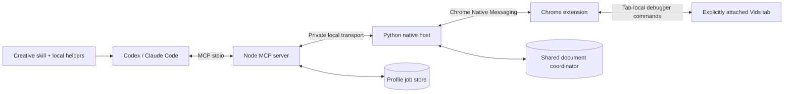

# Architecture, permissions and data

[Version 0.4: multiple attachments, chat bindings, resource admission and a shared monitor](parallel.md). The diagrams below describe one addressed session; several such sessions can coexist.

[English](architecture.md) · [Русский](../ru/architecture.md) · [Home](../../README.md)

Vids Studio is local infrastructure for an AI client to operate one user-selected Google Vids tab. It is an unofficial UI bridge, not a Google API integration. Google remains responsible for the editor, account permissions, generation and rendering.

## Separate identities, shared implementation

`profiles/codex.json` and `profiles/claude.json` contain public extension keys, host names, socket namespaces, MCP names and skill names. Those extension keys establish stable extension IDs; they are public manifest material, not authentication secrets.

`build_profiles.py` generates `profile.json`, `extension/profile.js` and a file manifest. Both client installations derive from the same core and receive the same `coreBuildId` when the runtime code matches. Client wrappers preserve their own identity and tool routing.

At runtime, MCP, host and extension exchange profile/version/build information. Version 0.2 uses local protocol **3** and extension envelope **2**. Incompatibility returns `RECONNECT_REQUIRED` before browser input. `vids_diagnostics` reads metadata without a UI snapshot or control lease, and remains available when the coordinator cannot be opened.

A valid source build does not prove those files are loaded. An old extension service worker, host or MCP process must be explicitly refreshed. Both profiles need the new runtime for cross-profile coordination.

## Permissions and connection scope

| Chrome permission | Use in this implementation |
| --- | --- |
| `activeTab` | User-initiated attachment of the intended tab |
| `debugger` | Accessibility, viewport capture and input within the attached target |
| `nativeMessaging` | Local connection to the profile's Python host |
| `storage` | Attachment metadata and bounded receipts confirming an old debugger was detached |
| `downloads` | Correlate and inspect a specifically triggered export download |

The code validates the exact Vids document before operations and revokes its session when the target changes. It does not enumerate other tabs, navigate to another document automatically, read cookies/passwords, or use OS input. Keyboard shortcuts for the OS, browser and clipboard are blocked. The declared debugger permission itself is broader than the implementation's policy; it should not be mistaken for a browser-enforced document-only permission.

Uploads use a verified file input or an intercepted chooser in the attached target. Cross-origin or out-of-process iframe targets are not silently adopted. The export watcher queries only its matched numeric download ID; it does not scan general download history.

## Control belongs to a task

The task obtains an opaque `controlToken` through `vids_acquire_control`. Observation, screenshots and input all require that capability and the attached `sessionId`. Mutations also require a fresh `snapshotId` and an action identifier. Tokens are not shareable agent coordination messages.

The native coordinator combines a private SQLite registry with per-document OS locks. It keys ownership by **document ID**, even if two profiles attach different tabs for the same document. Different documents remain independent. A busy document returns `CONTROL_BUSY`; there is no force-takeover tool. Normal activity renews ownership; idle expiry does not authorize replay of an unfinished action.

This coordinates participating Vids Studio profiles. It does not prevent a person or unrelated extension from editing the document. Pass control before manually editing the same document. Reading another task's status is not permission to borrow its token.

## Unknown outcomes are preserved

Before dispatching a mutation, the host persists its intent. An initial action receipt records `performed`, `not_performed` or `unknown`. Late evidence is appended rather than rewriting an unknown receipt into a fabricated original success.

A crash, elapsed timeout or dead PID cannot prove a browser action stopped. The extension must revoke the old JavaScript generation, confirm debugger detachment and persist a receipt. A new explicit attachment supplies that evidence to the coordinator. If detachment cannot be confirmed, recovery stops; it does not search for other targets or automatically reconnect.

After a confirmed fence, an unfinished action remains unknown. The new owner can receive `mode: reconcile`: observation works, but new mutations are blocked. `vids_reconcile_control` requires a meaningful description of inspection or an explicit recovery decision preserving the old unknown. It enables new work; it does not retry the old action or claim the old outcome is known.

A delayed status response is also bound to its generation. It cannot restore an old session after a new attachment. Stopping an MCP client does not intentionally detach the still-connected native host or Vids tab.

## Data and storage

The connector opens no public TCP listener and runs no hosted backend. Local transport uses stdio and Native Messaging; Linux/macOS use a private Unix socket, while Windows uses IPv4 loopback with a mutual HMAC handshake. A fresh per-host secret is stored in an owner-private descriptor. Client commands are sent only after the host proves possession; the secret is never sent on the connection. No Google OAuth client or model API credential is required by this bridge.

That does **not** mean the entire workflow is offline. Google Vids contacts Google normally. Explicit uploads send selected files to Google. UI observations and screenshots are returned to Codex or Claude Code and are handled according to that client's configuration and service terms.

| Local data | Default location and lifetime |
| --- | --- |
| Coordinator | `$XDG_STATE_HOME/vids-studio/coordinator`, or `~/.local/state/vids-studio/coordinator` |
| Export jobs | `$XDG_STATE_HOME/vids-studio-jobs/<profile>`, or the corresponding `~/.local/state` path |
| Diagnostic log | `bridge.log` beside the profile socket; bounded to 64 KiB |
| Setup rollback | `.runtime/install-backups/` inside the installation |
| Take archive | Beside the explicitly chosen manifest; retain it together with the manifest |

On Linux/macOS, private runtime directories are created as 0700 and private files as 0600. Windows validates owner-private ACLs and rejects reparse points; unsafe filesystem identities fail closed rather than silently loosening permissions. Raw control/job capabilities are not persisted; hashes support checks. The diagnostic log records bounded method/phase/code/time metadata, not page text, capability values, media paths or raw browser errors.

Resolved coordinator history is bounded by age/count; unresolved actions and required fences are preserved. Job retention is capped at 500 records, with terminal jobs and their private copies pruned after seven days on a later start. Retain needed exports elsewhere before expiry. Read [jobs](jobs.md) for full behavior. Rollback records can contain private configuration bytes and must stay private.

Do not delete the registry to bypass occupancy or an unknown outcome. Bounded local history is not an everlasting exactly-once guarantee for an external editor.

## Browser limitations

Chrome and the attached document must remain open. Background-window operation does not establish support through sleep, a closed browser, discarded tabs or every throttled rendering condition. A successful drag receipt still needs visual verification of its effect. DevTools may detach the extension debugger.

Export attribution relies on deprecated CDP Page download events plus Chrome download events and a full document referrer. It has specific unsupported cases; see [export limitations](jobs.md). Google can change UI labels, structure and feature availability independently of this repository.

References: [Chrome debugger API](https://developer.chrome.com/docs/extensions/reference/api/debugger), [Native Messaging](https://developer.chrome.com/docs/extensions/develop/concepts/native-messaging), [downloads API](https://developer.chrome.com/docs/extensions/reference/api/downloads). The implementation and its tests define this project's supported behavior; general API documentation does not prove a live Vids workflow passed.

Windows keeps persistent state below `%LOCALAPPDATA%/VidsStudio`; macOS uses `~/Library/Application Support/VidsStudio`. The socket/descriptor and coordinator are profile-aware; the coordinator is shared between clients. See [platform setup](platforms.md).
