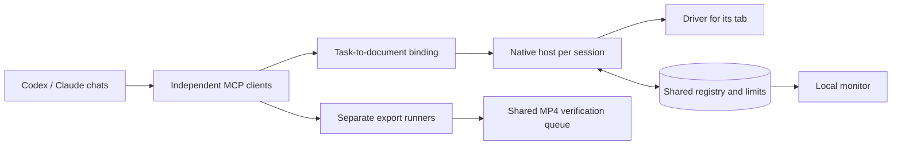

# Parallel work · 0.4

[Русский](../ru/parallel.md) · [Architecture](architecture.md) · [Testing](testing.md)

Several Codex and Claude chats can work in their own explicitly attached videos. Each tab has a driver, native process, local transport address and command queue. Attaching another video preserves existing connections. One document ID has one owner, including across the two profiles.



## Connect 5–10 videos

1. Update **all three layers** of the selected profile from one build: MCP, native host and extension. For two clients, build both profiles from the same canonical source. Reload the extension card during a suitable pause; reconnecting alone does not load new JavaScript. Do not interrupt another task's unsettled command.
2. Open the intended document and attach it through the popup. Repeat for other documents. The extension does not automatically select or attach unrelated tabs.
3. Give each chat the link to **its** video and that attachment's popup pairing code. The agent establishes a private binding and obtains its control token. Describe the desired result and authorized media in the task.
4. Run `bun run monitor` from either profile and open its printed local URL, including the private fragment. One panel covers both profiles.
5. Start with five tasks and watch actual capacity, memory and recovery. Ten attachments do not require the computer to perform ten captures or decodes simultaneously.

The panel listens only on loopback, validates Host/Origin and protects requests with a private capability. Do not publish its URL. It does not collect screenshots or take tab control. Opening it does not require switching the working Chrome window.

## Adaptive capacity

The person sets an upper bound; the shared governor determines current admission from measurements. Capture, upload/export and ordinary commands have separate limits within the overall budget. An unknown outcome retains its slot until confirmed settlement or fencing. This can reduce available concurrency; releasing it on a timer would invent free capacity.

Linux measures CPU, available memory and memory pressure: admission starts at two commands, ramps up gradually with headroom and decreases quickly under pressure. Unsupported Windows/macOS counters remain unknown; admission currently falls back to two browser commands and one local decode. The governor does not close existing tabs or stop other chats, so it cannot guarantee prevention of every OOM or shared GPU-process failure.

Local MP4 verification uses a separate, conservatively bounded queue covering copying, ffprobe and FFmpeg. A slot is released after the actual child process exits. A crash leaves an unsettled marker; neither its age nor a PID authorizes automatic deletion.

Global or per-video pause prevents new input, captures, uploads and export triggers; accessibility observations, status/diagnostics and existing download checks remain available. It does not cancel already-dispatched input or Google generation. A recent heartbeat does not establish completion of an external effect.

## Limits and acceptance

- Tasks, active model processes, attachments and concurrent commands are different counts. The panel does not substitute one for another.
- Sessions are logically isolated. Tabs in one Chrome share browser/GPU processes and memory. Separate browser processes with separate user-data directories reduce the impact of a browser crash; multiple profiles inside one browser do not provide that boundary. All still share machine RAM/GPU and Google quota.
- Google authentication and limits are shared by the account. An upper operation limit of fifty is configurable, but does not promise fifty heavy concurrent edits on any computer. The limit governs admitted commands, not the number of attached chats.
- Codex or Claude must continue their own task; the panel does not make an idle chat work. A separate export runner continues an existing export but does not write and edit the next video independently.
- The person's input in other apps is not used. Editing the same document manually requires a handoff.
- Keep the task's private `bindingToken` until its binding is released. Reconnecting or waiting for a TTL cannot recover a lost token; there is no automatic reassignment or force takeover.

Normal CI checks ten actual Chrome targets, ten MCP processes and ten native hosts on local pages, including a stalled screenshot and targeted detach. This is not acceptance against Google's live Vids UI.

An additional opt-in run uses actual Codex models and existing authentication, consuming account usage:

```sh
node scripts/parallel_smoke.mjs --run-agents --count 5 --report /absolute/private/acceptance.json
```

Choose 10 for a larger run. Temporary browser and working directories are created; live user browsers and documents are not used. The report distinguishes actual model processes from local fixture scope. It does not prove live generation, video quality or Google quota.

## Monitor preview

Synthetic examples, not live user videos.


