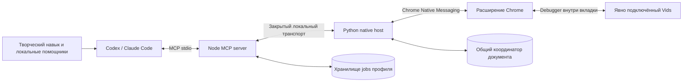

# Архитектура, разрешения и данные

[English](../en/architecture.md) · [Русский](architecture.md) · [Главная](../../README.ru.md)

Vids Studio — локальная инфраструктура, через которую AI-клиент управляет одной выбранной пользователем вкладкой Google Vids. Это неофициальный мост к интерфейсу, а не интеграция с Google API. Редактор, права аккаунта, генерация и рендер остаются на стороне Google.

## Отдельные идентификаторы, общая реализация

`profiles/codex.json` и `profiles/claude.json` содержат публичные ключи расширений, host names, socket namespaces, MCP names и имена навыков. Ключи закрепляют стабильные extension IDs; это публичная часть manifest, не секреты авторизации.

`build_profiles.py` генерирует `profile.json`, `extension/profile.js` и manifest файлов. Установки обоих клиентов строятся из общей основы и получают одинаковый `coreBuildId` при совпадающем runtime-коде. Клиентские wrappers сохраняют свои идентификаторы и маршрутизацию инструментов.

При работе MCP, host и extension обмениваются profile/version/build. Версия 0.2 использует локальный протокол **3** и envelope расширения **2**. Несовместимость возвращает `RECONNECT_REQUIRED` до ввода в браузере. `vids_diagnostics` читает метаданные без UI snapshot и lease; диагностика остаётся доступной при невозможности открыть coordinator.

Корректная сборка не доказывает, что её файлы загружены. Старый service worker расширения, host или MCP-процесс нужно явно обновить. Для межпрофильной координации новый runtime нужен обоим профилям.

## Разрешения и область подключения

| Разрешение Chrome | Использование в этой реализации |
| --- | --- |
| `activeTab` | Подключение нужной вкладки по действию пользователя |
| `debugger` | Accessibility, снимок viewport и ввод в подключённом target |
| `nativeMessaging` | Локальная связь с Python host выбранного профиля |
| `storage` | Метаданные подключения и ограниченные квитанции отключения старого debugger |
| `downloads` | Сопоставление и наблюдение конкретно запущенного экспорта |

Код проверяет точный документ Vids перед операциями и отзывает сессию при смене цели. Он не перечисляет другие вкладки, не переходит в другой документ автоматически, не читает cookie/пароли и не использует системный ввод. Сочетания клавиш ОС, браузера и clipboard блокируются. Само разрешение debugger шире политики реализации; это не ограничение браузера, разрешающее доступ только к одному документу.

Загрузка использует проверенный file input или перехваченный chooser в подключённой цели. Cross-origin и out-of-process iframe не подключаются незаметно. Наблюдатель экспорта запрашивает только сопоставленный numeric download ID и не просматривает общую историю загрузок.

## Управление принадлежит задаче

Задача получает непрозрачный `controlToken` через `vids_acquire_control`. Наблюдение, снимки и ввод требуют этот capability и подключённый `sessionId`. Мутации дополнительно требуют свежий `snapshotId` и идентификатор действия. Токены не передаются между агентами для координации.

Native coordinator объединяет закрытый SQLite registry с блокировками ОС на документ. Владение привязано к **document ID**, даже если два профиля подключили разные вкладки одного документа. Разные документы независимы. Занятый документ возвращает `CONTROL_BUSY`; инструмента принудительного захвата нет. Обычная активность продлевает владение; истечение idle срока не разрешает повтор незавершённого действия.

Это координация участвующих профилей Vids Studio. Человек и стороннее расширение по-прежнему могут редактировать документ. Перед ручной правкой того же документа передайте управление. Чтение статуса другой задачи не разрешает использовать её токен.

## Неизвестный исход сохраняется

До отправки мутации host записывает intent. Первичная квитанция содержит `performed`, `not_performed` или `unknown`. Позднее свидетельство добавляется отдельно, не превращая прежний unknown в вымышленный первоначальный успех.

Сбой, истёкший тайм-аут и мёртвый PID не доказывают, что действие в браузере остановилось. Расширение должно отозвать старое поколение JavaScript, подтвердить отключение debugger и сохранить квитанцию. Новое явное подключение передаёт это свидетельство coordinator. Если отключение нельзя подтвердить, восстановление останавливается; другие цели не ищутся, автоматического reconnect нет.

После подтверждённого отключения незавершённое действие остаётся неизвестным. Новый владелец может получить `mode: reconcile`: наблюдение разрешено, новые мутации блокируются. `vids_reconcile_control` требует содержательное описание осмотра или явного решения восстановить работу с сохранением старого unknown. Оно разрешает новую работу, но не повторяет прежнее действие и не объявляет его исход известным.

Запоздавший status тоже привязан к поколению: он не может восстановить старую сессию после нового подключения. Остановка MCP-клиента намеренно не отключает исправно подключённые native host и Vids.

## Данные и хранение

Коннектор не открывает публичный TCP-порт и не запускает облачный backend. Локальный транспорт — stdio и Native Messaging. На Linux/macOS используется закрытый Unix socket, на Windows — IPv4 loopback с взаимной HMAC-аутентификацией. Свежий секрет native host хранится в закрытом файле; команды отправляются только после проверки host, сам секрет по соединению не передаётся. Самому мосту не нужны Google OAuth client или ключ API модели.

Это **не** делает весь процесс офлайн. Google Vids общается с Google обычным образом; выбранные для upload файлы отправляются Google. Наблюдения и снимки передаются Codex или Claude Code и обрабатываются согласно настройкам и условиям соответствующего клиента.

| Локальные данные | Расположение и срок |
| --- | --- |
| Coordinator | `$XDG_STATE_HOME/vids-studio/coordinator` либо `~/.local/state/vids-studio/coordinator` |
| Export jobs | `$XDG_STATE_HOME/vids-studio-jobs/<profile>` либо соответствующий путь в `~/.local/state` |
| Диагностический журнал | `bridge.log` рядом с socket профиля; не более 64 KiB |
| Откат setup | `.runtime/install-backups/` внутри установки |
| Архив дублей | Рядом с явно выбранным manifest; хранится вместе с ним |

Закрытые runtime-каталоги создаются с режимом 0700, файлы — 0600; небезопасная идентичность файловой системы вызывает отказ, а не ослабление прав. Сырые control/job capabilities не сохраняются; для проверок используются hashes. Журнал содержит ограниченные method/phase/code/time, без текста страницы, capabilities, путей медиа и сырых ошибок браузера.

Разрешённая история coordinator ограничена сроком и количеством; unresolved операции и нужные fences сохраняются. Jobs ограничены 500 записями, terminal jobs и их закрытые копии очищаются через семь дней при следующем start. Сохраните нужный экспорт в другом месте до истечения срока. Полное поведение описано в [jobs](jobs.md). Rollback-файлы могут содержать приватные настройки и должны оставаться закрытыми.

Не удаляйте registry для обхода занятости или неизвестного исхода. Ограниченная локальная история не является вечной гарантией exactly-once для внешнего редактора.

## Ограничения браузера

Chrome и подключённый документ должны оставаться открытыми. Работа в фоновом окне не подтверждает работу во сне, при закрытом браузере, выгруженной вкладке или всех режимах throttling. Успешная квитанция drag всё равно требует визуальной проверки результата. DevTools могут отключить debugger расширения.

Сопоставление экспорта использует устаревающие CDP Page download events, события загрузки Chrome и полный referrer документа. Есть конкретные неподдерживаемые случаи: см. [ограничения экспорта](jobs.md). Google может независимо менять подписи, структуру UI и доступность возможностей.

Источники: [Chrome debugger API](https://developer.chrome.com/docs/extensions/reference/api/debugger), [Native Messaging](https://developer.chrome.com/docs/extensions/develop/concepts/native-messaging), [downloads API](https://developer.chrome.com/docs/extensions/reference/api/downloads). Поддерживаемое поведение проекта задают реализация и тесты; общая API-справка не доказывает успешный живой процесс в Vids.

На Windows вместо POSIX modes проверяются владелец и закрытые ACL; reparse points отклоняются. Состояние хранится в `%LOCALAPPDATA%/VidsStudio`, на macOS — в `~/Library/Application Support/VidsStudio`. Координатор общий для обоих клиентов. [Установка по платформам](platforms.md).
