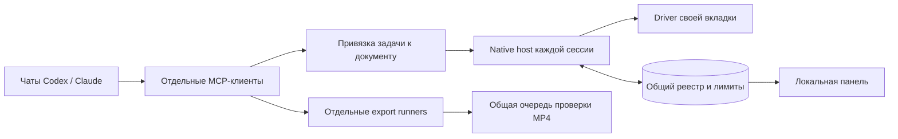

# Параллельная работа · 0.4

[English](../en/parallel.md) · [Архитектура](architecture.md) · [Тестирование](testing.md)

Несколько чатов Codex и Claude работают в своих явно подключённых роликах. Вкладка получает собственный driver, native process, адрес локального транспорта и очередь. Подключение следующего ролика сохраняет предыдущие. Один document ID имеет одного владельца, в том числе между двумя профилями.



## Подключить 5–10 роликов

1. Обновите **все три слоя** нужного профиля из одной сборки: MCP, native host, расширение. Для двух клиентов соберите оба профиля из одного canonical source. В удобной паузе перезагрузите карточку расширения; обычное переподключение не загружает новый JavaScript. Не делайте это во время чужой незавершённой команды.
2. Откройте нужный документ и подключите его через popup. Повторите для остальных документов. Расширение не выбирает и не подключает посторонние вкладки самостоятельно.
3. Передайте каждому чату ссылку на **его** ролик и pairing-код из строки этого подключения. Агент создаёт приватный binding и получает свой control token. В задании укажите желаемый результат и разрешённые медиа.
4. Запустите `bun run monitor` в одном из профилей. Откройте напечатанную локальную ссылку с приватным фрагментом. Одной панели достаточно для обоих профилей.
5. Начните с пяти задач и наблюдайте фактический допуск, память и recovery. Десять подключений не обязывают компьютер одновременно выполнять десять захватов или декодирований.

Панель слушает только loopback, проверяет Host/Origin и защищает запросы приватной capability. Не публикуйте её ссылку. Она не пересылает снимки и не забирает управление вкладками. Для открытия не требуется переключать рабочий Chrome.

## Как подбирается нагрузка

Человек задаёт верхнюю границу, общий регулятор — текущий допуск по измерениям. Скриншоты, upload/export и обычные команды имеют отдельные ограничители внутри общего бюджета. Неизвестный исход сохраняет занятый слот до подтверждённого завершения или fence. Это может временно уменьшить доступную параллельность; очистка по таймеру была бы ложным освобождением ресурсов.

Один слот зарезервирован для обычных браузерных команд: снимки и загрузки/экспорты вместе занимают не более текущего лимита минус один. При лимите один новые тяжёлые операции ждут. Если из-за нагрузки лимит опустился ниже уже занятой ёмкости, новые команды тоже ждут: регулятор не стирает незавершённую работу и не превышает бюджет ради фиктивного резерва. Статус и диагностика остаются доступны.

На Linux измеряются CPU, доступная память и memory pressure: допуск начинается с двух команд, растёт постепенно при запасе ресурсов и быстро снижается при нагрузке. На Windows/macOS недоступные счётчики отображаются как неизвестные; пока действует консервативный допуск двух команд и одного локального декодирования. Регулятор не закрывает уже открытые вкладки и не останавливает соседние чаты, поэтому не гарантирует защиту от любого OOM или сбоя общего GPU-процесса.

Локальная проверка MP4 выполняется в отдельной очереди с консервативным лимитом, включая копирование, ffprobe и FFmpeg. Слот освобождается после фактического завершения дочернего процесса. После аварии сохраняется отметка незавершённой проверки; её нельзя автоматически стирать по возрасту или PID.

Пауза всей группы или одного ролика запрещает новые ввод, снимки, загрузки и запуск экспорта; AX-наблюдения, status/диагностика и проверка уже начатой загрузки файла остаются доступны. Она не отменяет уже отправленное действие или Google-генерацию. Свежесть heartbeat не доказывает, что завершился внешний эффект.

## Ограничения и приёмка

- Количество задач, активных LLM-процессов, подключений и одновременно выполняемых команд — разные числа. Панель не подменяет одно другим.
- Сессии изолированы логически. Вкладки одного Chrome разделяют browser/GPU-процессы и память. Отдельные браузерные процессы с разными каталогами user data ограничивают последствия падения браузера; несколько профилей внутри одного процесса такой границы не дают. Общие RAM/GPU компьютера и квота Google сохраняются.
- Авторизация Google и его ограничения общие для аккаунта. Верхний предел в пятьдесят операций можно настроить, но это не обещание пятидесяти одновременных тяжёлых монтажей на любом компьютере. Лимит регулирует допуск команд, а не число подключённых чатов.
- Кодекс или Claude должны продолжать собственную задачу; панель не делает остановившийся чат работающим. Отдельный export runner продолжает уже начатый экспорт, но не сочиняет и не монтирует следующий ролик самостоятельно.
- Управление человека в другом приложении не используется. Одновременное ручное редактирование того же документа требует передачи управления.
- Сохраняйте приватный `bindingToken` задачи до освобождения её привязки. Переподключение или ожидание TTL не восстанавливают утраченный токен; автоматического переназначения и принудительного перехвата нет.

Обычный CI проверяет десять настоящих Chrome targets, десять MCP-процессов и десять native hosts на локальных страницах, включая зависший screenshot и адресный detach. Это не приёмка интерфейса Google Vids.

Отдельный, добровольный прогон использует настоящие Codex-модели и текущую авторизацию, расходуя лимит аккаунта:

```sh
node scripts/parallel_smoke.mjs --run-agents --count 5 --report /absolute/private/acceptance.json
```

Можно выбрать 10. Создаются временные браузерные и рабочие каталоги; живой браузер и документы не используются. Отчёт различает реальные процессы агентов и область локальной фикстуры. Он не доказывает живую генерацию, качество ролика или квоту Google.

## Вид панели

Синтетические примеры, а не живые ролики пользователя.


